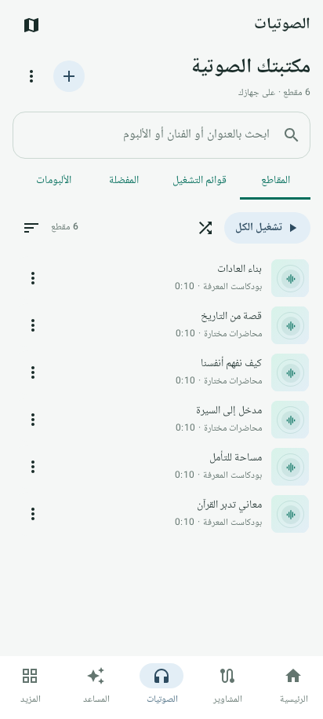
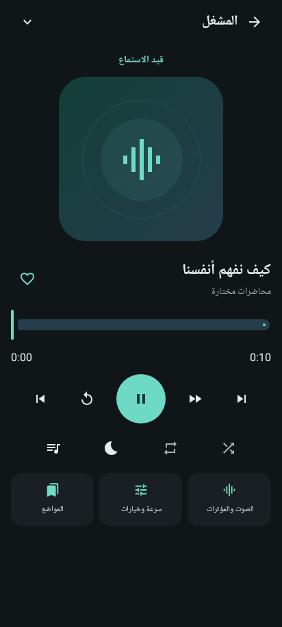
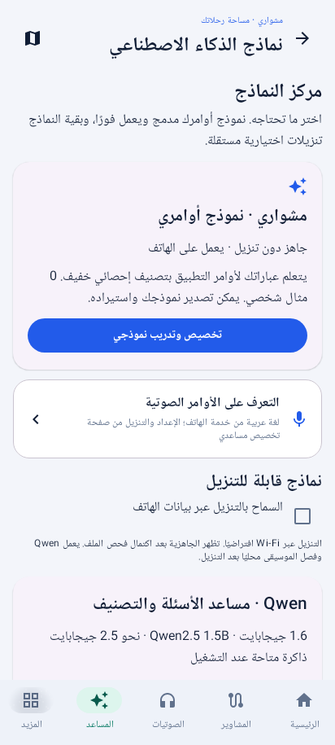
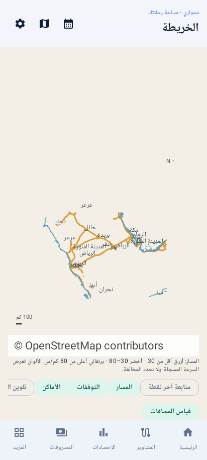

# تحميل مشواري

**[تحميل مشواري 6.0 — APK للأندرويد ARM64، نحو 103 ميجابايت](https://raw.githubusercontent.com/lm7md-ai/-/main/releases/app-v6.0.apk)**

تحديث بنفس الاسم والهوية والتوقيع لنسخ **1.3 و2.0 و3.x و4.x و5.x المنشورة هنا**.
أنه المشوار الجاري وثبّته فوق النسخة الموجودة دون حذف التطبيق أو مسح بياناته.
يحتفظ بالمشاوير والمصاريف؛ قاعدة الصوتيات مستقلة وقاعدة المشاوير تترقى تلقائيًا إلى 7 مع حفظ البيانات. يتطلب Android 8 أو أحدث.

**6.0:** تحسين حساب المسافة البطيئة، وحجز قفزات GPS، وحفظ المسار قبل تأكيد
البدء التلقائي، ووتيرة متكيفة للدقة الأعلى واسترداد المزود. مركز جاهزية وتشخيص
من الرئيسية، وتقرير جودة داخل المشوار، وقراءات GNSS عند توفرها.
[شرح ما تغير وحدود الاختبار](../android/docs/TRACKING_6.md). اجتاز 144 اختبار Android و13 اختبار أدوات.

**5.2:** مكتبة ومشغل مستقلان، وشريط تشغيل مصغر، وتبويبات واضحة، وقوائم للإضافة
والاستيراد والمؤثرات والمواضع؛ وهوية جديدة متسقة في الفاتح والداكن. فصل السجل
عن التحليل في المحفظة، وتبويبات للسيارة والإحصاءات وتحسين التقويم والمشاوير.
[أين تجد الأدوات وكيف تحدث بأمان](../android/docs/DESIGN_5_2.md). اجتاز 131 اختبار Android و13 اختبار أدوات.

**5.1:** إعدادات منظمة وقابلة للبحث، وتبويب للمساعد ومركز نماذج ظاهر مباشرة،
ونموذج أوامر شخصي يتدرّب على أمثلتك دون تنزيل، وأوامر صوتية بالضغط للتحدث.
التعرف الصوتي المحلي يعتمد على خدمة الهاتف وحزمة العربية؛ خيار الشبكة منفصل
واختياري. [الدليل وحدود الاختبار](../android/docs/ASSISTANT_5_1.md).

**5.0:** استوديو لتحسين حدة المحاضرات ووضوح الكلام؛ تنزيل Qwen محلي اختياري
(1.6 جيجابايت)، وتصنيف من العناوين حسب الموضوع والمصدر مع اختيار مجلدات المكتبة
أو النقل الفعلي بعد معاينة، وفصل الموسيقى بنموذجين اختياريين (40 ميجابايت).
لا يتغير الأصل أثناء المعالجة. [الاستخدام وحدود الاختبار](../android/docs/AUDIO_STUDIO_5.md).

**4.2:** أوضاع جاهزة ظاهرة أعلى المكتبة: طبيعي مباشر، 3D افتراضي، و7.1 محاكاة،
ومخصص. الطبيعي يستخدم إخراج Android القياسي دون مؤثرات الجهاز؛ توجد قراءة
لصوت الوسائط في الهاتف وتنبيه الكتم وزر استعادة التشغيل المباشر. 3D و7.1 تأثيرات
برمجية إلى ستيريو، وليسا إخراجًا فعليًا لثماني سماعات.
[طريقة الاستخدام وحدود تشخيص الصمت](../android/docs/AUDIO_4_2.md).

**إصلاح 4.1:** يعالج استثناءً في معالج الصوت عند استقبال مخزن فارغ من Media3،
كان يوقف المقاطع الثنائية حتى مع تعطيل اتساع الستيريو. لا تحتاج حذف المكتبة أو
إعادة إضافة المقاطع. يفصل رسائل أخطاء القراءة والترميز والإخراج ويزيل التنبيه
القديم عند إعادة المحاولة. [تفاصيل الإصلاح](../android/docs/AUDIO_FIX_4_1.md).

4.0 يضيف مكتبة ملفات صوتية محلية دون إنترنت، واستيراد ملفات ومجلدات وفحص الهاتف،
وبحثًا وتصنيفًا ومفضلة وقوائم تشغيل قابلة للترتيب وصور أغلفة. يدعم مشغل Media3
التشغيل الخلفي والتحكم من الإشعارات وشاشة القفل والبلوتوث، حفظ موضع الاستماع
والإشارات وقائمة الانتظار، السرعة وتجاوز الصمت ومؤقت النوم. توجد تأثيرات EQ
وجهير ومحيطي وفق دعم الجهاز واتساع ستيريو اختياري؛ هذا ليس 7.1 منفصل القنوات.
تصدير سجل المكتبة واستعادته وإعادة ربط الملف لا يغير بيانات المشاوير.
**[دليل استخدام مكتبة الصوتيات](../android/docs/AUDIO_4.md)**.

3.2 مبني بوضع Release غير قابل للتصحيح مع نفس التوقيع. أصلح تداخل أوامر
التتبع، ودعم تأكيد القيادة عند غياب حقل السرعة، واستبعاد الموقع القديم/الوهمي
عند تحديد البيت، والتحقق من الاستعادة وصور الخرائط. لا يتغير مخطط البيانات 6.
[تقرير الفحص وما يحتاج تجربة على الهاتف](../android/docs/AUDIT_3_2.md) ·
[خيارات التطوير](../android/docs/ROADMAP.md).

3.1 يصلح صيغة الراجحي «شراء PoS / بـSR / لـالتاجر»، والاستقبال من إشعارات
متعددة الأسطر، ويضيف إذن استقبال الرسائل الجديدة مباشرة وإضافة رسالة فائتة
باللصق مع حالة تشخيص. ويضيف محفّز مغادرة/دخول نطاق البيت، ويصلح تأكيد القيادة
بعد انتظار طويل، ويعيد المحفّزات بعد التحديث. لا تتغير قاعدة البيانات 6.
[إعداد الإصلاحات وحدود الاختبار على الهاتف](../android/docs/HOTFIX_3_1.md).

يشمل:

- خريطة طرق ومدن للسعودية دون إنترنت، بحثًا محليًا وطبقات وقياس مسافات
  وتلوين سرعة وأماكن محفوظة ومشاركة نقطة وتفاصيل التوقفات.
- حساب الاستهلاك الفعلي من عداد السيارة والتعبئات الكاملة والجزئية.
- ملخص اليوم والأسبوع والشهر، تحليل الوجهات ومقارنة المسارات المسجلة.
- بدء فحص القيادة عند اتصال بلوتوث السيارة، واستبعاد إشارات قديمة/وهمية
  وGPS احتياطي، مع إبقاء الدقة الأعلى خيارًا.
- ميزانيات لكل فئة، قواعد للتجار، ومصاريف شهرية تُسجّل بعد تأكيد السداد.
- مراجعة الرحلات بدمجها وتقسيمها، مع حفظ المسار والمصاريف والملاحظات.

**[دليل استخدام مزايا 3.0](../android/docs/VERSION_3.md)**

الخرائط مضمنة؛ أول فتح يجهز قاعدة محلية بحجم نحو 133 MiB دون تنزيل إضافي.
هي بيانات طرق ومدن، وليست ملاحة صوتية أو ازدحامًا مباشرًا. الاستهلاك الفعلي
يحتاج تعبئتين كاملتين وقراءتي عداد وتسجيل التعبئات بينهما؛ رسالة البنك وحدها
لا تثبت لترات الوقود. اجتازت النسخة 106 اختبار Android و13 اختبار أدوات.
فحوص الخادم القديم والويب السابقة موثقة في تقرير 3.2. اعتماديات مشروع الويب القديم
ما زالت تحمل 29 تنبيه npm كما يوضح تقرير الفحص؛ هذه ليست اعتماديات APK الأصلي.
لم يتوفر هاتف RedMagic لتجربة GPS/بلوتوث والبطارية عمليًا.

## صور فعلية من بيئة الاختبار

صورة المكتبة من محاكاة Android بمقطع اختبار اصطناعي، دون أي ملفات شخصية.

| الفاتح | الداكن |
|---|---|
|  |  |

الصور مولدة من واجهة Android ومحرك الرسم الفعليين في المحاكاة، ببيانات حساب
فارغة وخرائط OSM عامة؛ لا تتضمن مشاوير أو مصاريف شخصية وهمية.

## النسخة المستقلة والملفات السابقة

إذا ثبّتَّ نسخة باسم الحزمة `sa.rihla.next`، استخدم
[تحديث 6.0 للنسخة المستقلة](https://raw.githubusercontent.com/lm7md-ai/-/main/releases/app-v6.0-independent.apk).
أما للمثبتين على 1.3 أو 2.0 أو 3.x أو 4.x الأساسية، فاختاروا الرابط الأساسي أعلاه.
النسخة الأولى ذات التوقيع المختلف تحتاج نقلًا محليًا؛ لا تُحذف لتجاوز التعارض.

[2.0 الأساسي](app-v2.0.apk) · [2.0 المستقل](app-v2.0-independent.apk) · [1.3](app-v1.3.apk)

[أداة نقل ويندوز للإصدارات القديمة](mashwari-transfer-windows.zip) ·
[دليل USB](../android/docs/WINDOWS_MIGRATION.md) ·
[النقل من الهاتف فقط](../android/docs/PHONE_MIGRATION.md)

بصمات الإصدار الحالي في [SHA256SUMS-v6.0](SHA256SUMS-v6.0).

بصمات الملفات السابقة والخريطة:

| الملف | SHA-256 |
|---|---|
| مشواري 4.2 الأساسي | `b8b8fe187a029d5d6e73ef9acb8ce76b15bf6321b6c2a4d7d6621b38fc3986b3` |
| مشواري 4.2 المستقل | `c72bc1e1c18a95f1d8dd09bcf352919aee0e7e39545818aa6420f2942ba2dac6` |
| مشواري 4.1 الأساسي | `1ada17c76e82c6caeddbefe80bf632b19724e0c9c72c66c0c85bca8120e31231` |
| مشواري 4.1 المستقل | `9a28795aea8096babb3ecfa0f5dea95bed6be05f161f14f48e3449fd2213f2c3` |
| مشواري 4.0 الأساسي | `f492aa44a4504d3b229b714a47e0d2d30d6bbc8ce9e6f80f7e67d762a8ecec05` |
| مشواري 4.0 المستقل | `f6b721dbd290a4fec72c47e4d5ec81b49d4e97329f5f8cfdbe69c2aef76c3cc7` |
| مشواري 3.2 الأساسي | `bc084fecf8ac29497a081e84fa6b0047f3b8c290b0a04450aa7e7b0cf52d57ed` |
| مشواري 3.2 المستقل | `99445cca0fde2ea4a50c193af8b360809d05325a6dbaa27e5a200c5e750c8bf0` |
| مشواري 3.1 الأساسي | `cef70ac2e2504fdeb192607fc4ae9489452d4b1773d8bdaad02ead319635fb6b` |
| مشواري 3.1 المستقل | `80231ee631713de0b43b0784a13fd0f8d9c81e953a7d0ba4f4645dbb19961ccd` |
| مشواري 3.0 الأساسي | `cb8ba80418c2b2b6cb3c7c687eb7da7fc007fa03d2df65cbd3872b49c3c3ad45` |
| مشواري 3.0 المستقل | `1358da21d3ec791615b39a565bb2f616ba3ea7d6ee57dd7161d2b4923f46c4cf` |
| بيانات خريطة السعودية المشتقة | `fc47bcdafc88c41b9223666099fd327cf5386ceba5b9837695a831fbc659e7dd` |

رخصة البيانات ومصدرها في [دليل الخرائط](../android/maps/README.md)، والتفاصيل
الفنية وحدود التحقق في [تقرير الفحص](../android/VERIFICATION.md).
